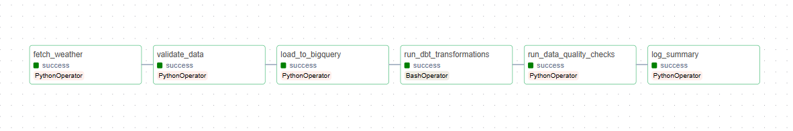
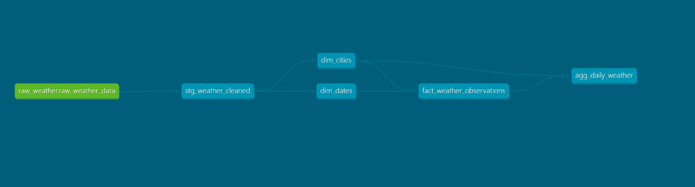
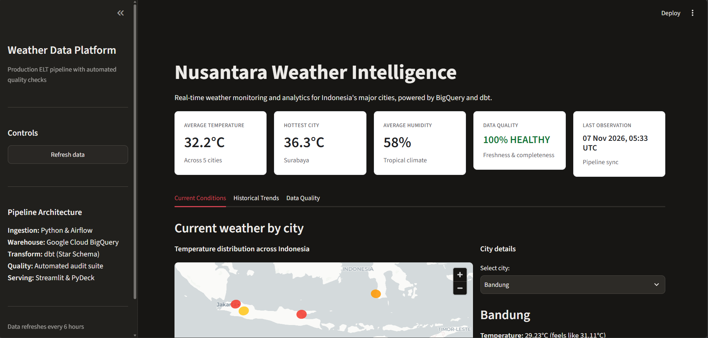

# Weather Data Pipeline: OpenWeatherMap to BigQuery

A batch ELT pipeline that collects current weather for five Indonesian cities every 6 hours, loads it into **BigQuery**, models it with **dbt**, and checks its health with an automated **data quality audit**. **Apache Airflow** (Docker Compose) orchestrates everything, and a **Streamlit** dashboard reads the results.

**Status:** runs end to end locally with Docker Compose. It has been running on a 6-hour schedule since 2 November 2026, with gaps when the local machine or its connection was off (see [Known failures](#known-failures)). It is a portfolio project, not a hosted service.

## Results so far

| Metric | Value (as of 7 Nov 2026) |
|--------|--------------------------|
| Cities covered | 5 (Jakarta, Surabaya, Bandung, Medan, Makassar) |
| Schedule | every 6 hours (`0 */6 * * *`, Asia/Jakarta time) |
| Rows in `raw_weather_data` | 75 (5 cities × 15 loads), 2 Nov – 7 Nov 2026 |
| Duplicate rows removed by dbt so far | 0 (75 raw rows, 75 unique observations) |
| DAG runs | 14 successful of 16 (87.5%), including manual test runs |
| dbt tests | 24 passing |
| Latest data quality score | 100 / 100 (7 Nov 2026) |





## Architecture

```
OpenWeatherMap API
        |
        v
Airflow DAG (every 6 hours, 2 retries, 5-minute delay)
  fetch_weather
    -> validate_data            (warns only; does not stop the run)
    -> load_to_bigquery         (append to raw table, partitioned by day)
    -> run_dbt_transformations  (dbt run, then dbt test)
    -> run_data_quality_checks  (audit; critical failure stops the DAG)
    -> log_summary
        |
        v
BigQuery
  weather_data           raw_weather_data
  weather_data_staging   stg_weather_cleaned (view)
  weather_data_marts     dim_cities, dim_dates, fact_weather_observations,
                         agg_daily_weather, data_quality_audit_log
        |
        v
Streamlit dashboard (current conditions, historical trends, data quality)
```

## Tech stack

- Apache Airflow 2.8.1 (LocalExecutor), PostgreSQL 14 for Airflow metadata
- Google BigQuery (region `asia-southeast2`)
- dbt Core with `dbt-bigquery` 1.7.4
- Python, `requests`, `google-cloud-bigquery`
- Streamlit and Plotly for the dashboard
- Docker and Docker Compose

## Data model

| Layer | Model | Notes |
|-------|-------|-------|
| Raw | `raw_weather_data` | Appended on every run; table partitioned by day on `timestamp` |
| Staging | `stg_weather_cleaned` | Casts types, filters null cities and timestamps, builds `observation_id` (MD5 of city and timestamp), and removes duplicates with `QUALIFY ROW_NUMBER()` |
| Marts | `dim_cities`, `dim_dates` | Dimensions with MD5 surrogate keys |
| Marts | `fact_weather_observations` | Partitioned by `observation_date`, clustered by `city_id` and `weather_main` |
| Marts | `agg_daily_weather` | Daily average, min and max temperature, humidity, pressure, wind speed, and dominant weather per city |

dbt tests cover `not_null`, `unique`, and `relationships` on the staging and mart models (24 tests).

## Data quality

Quality is checked in three places:

1. **In the DAG (`validate_data`)**: required fields and plausible ranges for each record. It only logs warnings.
2. **In dbt**: `not_null`, `unique`, and `relationships` tests run after every `dbt run`. A failing test fails the task.
3. **Audit (`WeatherQualityChecker`)**: runs after dbt and writes every result to `weather_data_marts.data_quality_audit_log`.
   - **Freshness**: the latest observation must be within the 7-hour SLA
   - **Completeness**: all five expected cities must be present
   - **Climate range**: temperature 15-45 °C, humidity 20-100%, pressure 900-1100 hPa
   - Each check scores PASS (100), WARN (50) or FAIL (0), and the overall score is the average. A critical failure raises an error and stops the DAG.

To read the overall score of the latest audit:

```sql
SELECT
  check_timestamp,
  ROUND(AVG(CASE status WHEN 'PASS' THEN 100 WHEN 'WARN' THEN 50 ELSE 0 END), 1) AS quality_score
FROM `PROJECT_ID.weather_data_marts.data_quality_audit_log`
GROUP BY check_timestamp
ORDER BY check_timestamp DESC
LIMIT 1;
```

## Getting started

### Prerequisites

- Docker and Docker Compose
- An [OpenWeatherMap](https://openweathermap.org/api) API key
- A Google Cloud project with BigQuery enabled and a service account key (JSON)

### Setup

```bash
git clone https://github.com/uca-spider/weather-data-engineering.git
cd weather-data-engineering

cp .env.example .env
# Edit .env: GCP_PROJECT_ID, OPENWEATHER_API_KEY, and the Airflow login

# Put your service account key here (this folder is git-ignored)
mkdir -p credentials
cp /path/to/your-key.json credentials/gcp-credentials.json
```

Create the dbt datasets once, then start Airflow:

```bash
python src/setup_dbt_datasets.py       # creates the staging and marts datasets
docker compose up airflow-init
docker compose up -d
```

Open Airflow at <http://localhost:8080>, log in with the user you set in `.env`, unpause `weather_ingestion_pipeline`, and trigger a run.

### Dashboard

```bash
pip install -r requirements-dashboard.txt
streamlit run src/dashboard/app.py
```

The dashboard has three tabs: **Current Conditions** (map and city details), **Historical Trends** (daily aggregates), and **Data Quality** (audit log).

> Never commit `.env` or anything in `credentials/`. Both are listed in `.gitignore`.

### Checking pipeline health

Count DAG runs by state from the Airflow metadata database:

```bash
docker compose exec -T postgres psql -U airflow -d airflow -c "SELECT run_type, state, COUNT(*) FROM dag_run WHERE dag_id='weather_ingestion_pipeline' GROUP BY run_type, state ORDER BY run_type, state;"
```

## Project structure

```
weather-data-engineering/
├── airflow/dags/
│   └── weather_ingestion_pipeline.py   # Ingestion DAG
├── dbt/weather_dbt/
│   ├── models/staging/                 # stg_weather_cleaned + sources and tests
│   └── models/marts/                   # dim, fact and aggregate models + tests
├── src/
│   ├── ingestion/                      # API fetcher and BigQuery loader
│   ├── validation/                     # WeatherQualityChecker
│   └── dashboard/                      # Streamlit app
├── docs/images/                        # Screenshots used in this README
├── docker-compose.yml
├── Dockerfile                          # Airflow image with dbt installed
├── .env.example
└── requirements.txt
```

## Design decisions and trade-offs

- **Append to raw, deduplicate in dbt.** The loader uses `insert_rows_json` (streaming inserts) and never updates rows. Duplicates are removed in the staging layer. The raw table is a full history, but the loader itself is not idempotent. Re-running a failed task can add duplicate raw rows, which dbt then removes. No duplicates have occurred so far (75 raw rows, 75 unique observations), so this mechanism is covered by dbt's `unique` test but not yet exercised by real duplicates.
- **Partitioning and clustering.** The raw table is partitioned by day, and the fact table is partitioned by date and clustered by city and weather type, to limit the data scanned by dashboard queries.
- **Quality gate after dbt.** The audit reads the marts, so it checks what the dashboard actually shows, and a stale or incomplete load stops the pipeline.
- **6-hour schedule.** Weather changes slowly, and 6 hours keeps API calls and BigQuery usage small.

## Known failures

Two of 16 runs failed (4 and 5 Nov 2026, the 18:00 WIB slot). In both cases `fetch_weather` failed on all three attempts with connection errors for every city within milliseconds. The cause was that the local machine was offline: the pipeline runs on a laptop that uses a mobile hotspot, which was switched off at that time of day. No data was loaded for those slots, and the downstream tasks were marked `upstream_failed`. The current-weather endpoint cannot be backfilled, so those slots remain gaps in the data.

## Limitations

- Runs on a laptop over a mobile hotspot, so the schedule has gaps whenever the machine or the connection is off
- Missed slots cannot be backfilled, because the API returns only current conditions
- Single data source (OpenWeatherMap) and five cities, so the data volume is small (about 20 rows per day)
- The loader uses streaming inserts and is not idempotent (see above)
- `validate_data` only warns; the real stopping gate is the audit
- No unit tests for the Python code yet (the dbt tests are the automated checks)
- Great Expectations is not used; quality checks are custom
- No alerting; failures are visible only in the Airflow UI

## Roadmap

- [ ] Unit tests for the fetcher, loader and quality checker (pytest), run in GitHub Actions
- [ ] Log the underlying exception for connection errors in the fetcher, so the cause is visible in the Airflow logs
- [ ] Make the load idempotent (load jobs or `MERGE` on `observation_id`)
- [ ] Run the pipeline on an always-on host so the schedule has no gaps
- [ ] Add alerts on audit or task failure (email or chat webhook)
- [ ] Evaluate a second data source with historical data (for example Open-Meteo) for backfill and cross-source checks
- [ ] Deploy the dashboard

## Acknowledgements

Weather data from [OpenWeatherMap](https://openweathermap.org/).
