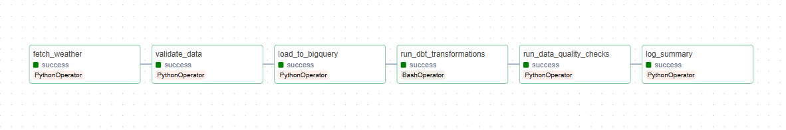
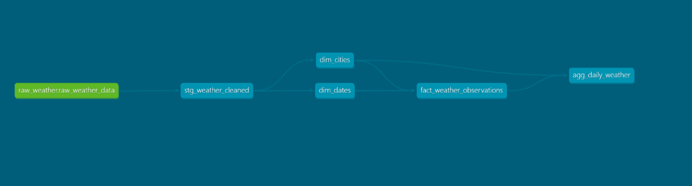
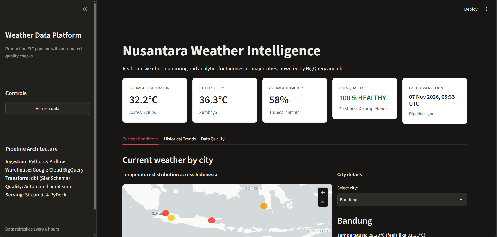

# Weather Data Pipeline: OpenWeatherMap to BigQuery

A batch ELT pipeline that collects current weather for five Indonesian cities every 6 hours, loads it into **BigQuery**, models it with **dbt**, and checks its health with an automated **data quality audit**. It runs two ways: **Apache Airflow** (Docker Compose) locally, and **GitHub Actions** on a schedule in the cloud. A **Streamlit** dashboard reads the results.

**Status:** runs end to end two ways — locally with Docker Compose (Airflow), and in the cloud on **GitHub Actions** (scheduled every 6 hours). It has been collecting data since 2 November 2026. Moving the schedule to GitHub Actions removed the gaps caused by the local machine being off, though GitHub Actions scheduled triggers are best-effort and occasionally skip a run (see [Known failures](#known-failures)). It is a portfolio project, not a hosted service.

## Results so far

| Metric | Value (as of 22 Nov 2026) |
|--------|---------------------------|
| Cities covered | 5 (Jakarta, Surabaya, Bandung, Medan, Makassar) |
| Schedule | every 6 hours (`19 */6 * * *`) — GitHub Actions (UTC) and local Airflow (Asia/Jakarta) |
| Rows in `raw_weather_data` | 175 (5 cities × 35 loads), 2 Nov – 22 Nov 2026 |
| Duplicate rows removed by dbt so far | 0 (175 raw rows, 175 unique observations) |
| dbt tests | 24 passing |
| Latest data quality score | 100 / 100 (22 Nov 2026) |





## Architecture

```
OpenWeatherMap API
        |
        v
Orchestration — same ELT steps, two runners:
  - GitHub Actions: cron every 6 hours (19 */6 * * *, UTC) -> src/pipeline_runner.py (cloud, no local machine needed)
  - Airflow DAG (local, Docker): every 6 hours, 2 retries, 5-minute delay

  fetch_weather
    -> validate_data            (warns only; does not stop the run) [Airflow DAG only]
    -> load_to_bigquery         (BigQuery load job, append to raw table, partitioned by day)
    -> run_dbt_transformations  (dbt run, then dbt test)
    -> run_data_quality_checks  (audit; critical failure stops the run)
    -> log_summary
        |
        v
BigQuery
  weather_data           raw_weather_data
  weather_data_staging   stg_weather_cleaned (view)
  weather_data_marts     dim_cities, dim_dates, fact_weather_observations,
                         agg_daily_weather, data_quality_audit_log
        |
        v
Streamlit dashboard (current conditions, historical trends, data quality)
```

## Tech stack

- Apache Airflow 2.8.1 (LocalExecutor), PostgreSQL 14 for Airflow metadata
- GitHub Actions (scheduled cloud runner for the pipeline)
- Google BigQuery (region `asia-southeast2`)
- dbt Core with `dbt-bigquery` 1.7.4
- Python, `requests`, `google-cloud-bigquery`
- Streamlit and Plotly for the dashboard
- Docker and Docker Compose

## Data model

| Layer | Model | Notes |
|-------|-------|-------|
| Raw | `raw_weather_data` | Appended on every run with a BigQuery load job; table partitioned by day on `timestamp` |
| Staging | `stg_weather_cleaned` | Casts types, filters null cities and timestamps, builds `observation_id` (MD5 of city and timestamp), and removes duplicates with `QUALIFY ROW_NUMBER()` |
| Marts | `dim_cities`, `dim_dates` | Dimensions with MD5 surrogate keys |
| Marts | `fact_weather_observations` | Partitioned by `observation_date`, clustered by `city_id` and `weather_main` |
| Marts | `agg_daily_weather` | Daily average, min and max temperature, humidity, pressure, wind speed, and dominant weather per city |

dbt tests cover `not_null`, `unique`, and `relationships` on the staging and mart models (24 tests).

## Data quality

Quality is checked in three places:

1. **In the Airflow DAG (`validate_data`)**: required fields and plausible ranges for each record. It only logs warnings, and runs only in the Airflow DAG (not in the GitHub Actions run).
2. **In dbt**: `not_null`, `unique`, and `relationships` tests run after every `dbt run`. A failing test fails the step. Runs in both runners.
3. **Audit (`WeatherQualityChecker`)**: runs after dbt in both runners, and writes every result to `weather_data_marts.data_quality_audit_log`.
   - **Freshness**: the latest observation must be within the 7-hour SLA (measured in seconds, so freshly loaded data is never misreported as stale)
   - **Completeness**: all five expected cities must be present
   - **Climate range**: temperature 15-45 °C, humidity 20-100%, pressure 900-1100 hPa
   - Each check scores PASS (100), WARN (50) or FAIL (0), and the overall score is the average. A critical failure raises an error and stops the run.

To read the overall score of the latest audit:

```sql
SELECT
  check_timestamp,
  ROUND(AVG(CASE status WHEN 'PASS' THEN 100 WHEN 'WARN' THEN 50 ELSE 0 END), 1) AS quality_score
FROM `PROJECT_ID.weather_data_marts.data_quality_audit_log`
GROUP BY check_timestamp
ORDER BY check_timestamp DESC
LIMIT 1;
```

## Getting started

### Prerequisites

- Docker and Docker Compose
- An [OpenWeatherMap](https://openweathermap.org/api) API key
- A Google Cloud project with BigQuery enabled and a service account key (JSON)

### Setup

```bash
git clone https://github.com/uca-spider/weather-data-engineering.git
cd weather-data-engineering

cp .env.example .env
# Edit .env: GCP_PROJECT_ID, OPENWEATHER_API_KEY, and the Airflow login

# Put your service account key here (this folder is git-ignored)
mkdir -p credentials
cp /path/to/your-key.json credentials/gcp-credentials.json
```

Create the dbt datasets once, then start Airflow:

```bash
python src/setup_dbt_datasets.py       # creates the staging and marts datasets
docker compose up airflow-init
docker compose up -d
```

Open Airflow at <http://localhost:8080>, log in with the user you set in `.env`, unpause `weather_ingestion_pipeline`, and trigger a run.

### Run in the cloud (GitHub Actions)

The same pipeline runs on a schedule in `.github/workflows/weather_pipeline.yml`, so it does not depend on the local machine being on. It calls `src/pipeline_runner.py`, which runs ingestion, dbt, and the quality audit in one process.

Set three repository secrets (**Settings → Secrets and variables → Actions**):

- `OPENWEATHER_API_KEY` — the OpenWeatherMap key
- `GCP_PROJECT_ID` — the Google Cloud project id
- `GCP_SA_KEY` — the full service account JSON

Then trigger it from the **Actions** tab with **Run workflow**, or wait for the 6-hour schedule. Note that GitHub only runs `schedule` triggers on a best-effort basis (see [Limitations](#limitations)).

### Dashboard

```bash
pip install -r requirements-dashboard.txt
streamlit run src/dashboard/app.py
```

The dashboard has three tabs: **Current Conditions** (map and city details), **Historical Trends** (daily aggregates), and **Data Quality** (audit log).

> Never commit `.env` or anything in `credentials/`. Both are listed in `.gitignore`.

### Checking pipeline health

Count DAG runs by state from the Airflow metadata database:

```bash
docker compose exec -T postgres psql -U airflow -d airflow -c "SELECT run_type, state, COUNT(*) FROM dag_run WHERE dag_id='weather_ingestion_pipeline' GROUP BY run_type, state ORDER BY run_type, state;"
```

For the cloud runner, check run history in the repository's **Actions** tab.

## Project structure

```
weather-data-engineering/
├── .github/workflows/
│   └── weather_pipeline.yml            # Scheduled cloud pipeline (GitHub Actions)
├── airflow/dags/
│   └── weather_ingestion_pipeline.py   # Ingestion DAG (local Airflow)
├── dbt/weather_dbt/
│   ├── models/staging/                 # stg_weather_cleaned + sources and tests
│   └── models/marts/                   # dim, fact and aggregate models + tests
├── src/
│   ├── ingestion/                      # API fetcher and BigQuery loader
│   ├── validation/                     # WeatherQualityChecker
│   ├── dashboard/                      # Streamlit app
│   └── pipeline_runner.py              # Standalone ELT runner for GitHub Actions
├── docs/images/                        # Screenshots used in this README
├── docker-compose.yml
├── Dockerfile                          # Airflow image with dbt installed
├── .env.example
├── requirements.txt
└── requirements-dashboard.txt          # Dashboard-only deps (Streamlit, Plotly, ...)
```

## Design decisions and trade-offs

- **Append to raw, deduplicate in dbt.** The loader uses a BigQuery load job (`load_table_from_json` with `WRITE_APPEND`) and never updates rows. Duplicates are removed in the staging layer. The raw table is a full history, but the loader itself is not idempotent. Re-running a failed task can add duplicate raw rows, which dbt then removes. No duplicates have occurred so far (175 raw rows, 175 unique observations), so this mechanism is covered by dbt's `unique` test but not yet exercised by real duplicates. The loader originally used streaming inserts (`insert_rows_json`), but those land in a buffer that is not immediately visible, so dbt could rebuild the marts before the new rows were queryable; a load job makes the data available synchronously.
- **Partitioning and clustering.** The raw table is partitioned by day, and the fact table is partitioned by date and clustered by city and weather type, to limit the data scanned by dashboard queries.
- **Quality gate after dbt.** The audit reads the marts, so it checks what the dashboard actually shows, and a stale or incomplete load stops the pipeline.
- **Freshness measured in seconds.** `TIMESTAMP_DIFF` in minutes rounds a just-loaded observation down to 0, and `0 or 9999` in Python then falls back to "no data"; measuring in seconds avoids that false alarm.
- **Scheduling is best-effort on GitHub Actions.** GitHub runs `schedule` triggers on a shared queue, so runs can be delayed 5–30 minutes or occasionally dropped, especially at the top of the hour. The cron is offset to minute 19 (`19 */6 * * *`) to avoid the busiest slots. Guaranteed timing would need a dedicated scheduler (Cloud Scheduler + Cloud Run, or an external cron calling `workflow_dispatch`); for a portfolio project the occasional miss is acceptable.
- **6-hour schedule.** Weather changes slowly, and 6 hours keeps API calls and BigQuery usage small.

## Known failures

Two of 16 early runs failed (4 and 5 Nov 2026, the 18:00 WIB slot). In both cases `fetch_weather` failed on all three attempts with connection errors for every city within milliseconds. The cause was that the local machine was offline: the pipeline ran on a laptop that uses a mobile hotspot, which was switched off at that time of day. No data was loaded for those slots, and the downstream tasks were marked `upstream_failed`. The current-weather endpoint cannot be backfilled, so those slots remain gaps in the data.

Since 21 November 2026 the pipeline also runs on GitHub Actions, which is not tied to the local machine, so the laptop-offline gaps no longer happen. GitHub Actions brings a different, smaller gap instead: scheduled runs are best-effort, so a run is sometimes delayed or dropped (observed: a 00:00 UTC run skipped, and an 18:00 UTC run started 47 minutes late). The cron was moved to minute 19 to reduce this, but occasional misses remain.

## Limitations

- Missed slots cannot be backfilled, because the API returns only current conditions
- GitHub Actions scheduled runs are best-effort: observed delays up to ~47 minutes and occasional dropped runs, especially at the top of the hour
- Single data source (OpenWeatherMap) and five cities, so the data volume is small (about 20 rows per day)
- The loader is not idempotent: a retried run can append duplicate raw rows, which dbt then deduplicates
- `validate_data` runs only in the Airflow DAG, not in the GitHub Actions run
- No unit tests for the Python code yet (the dbt tests are the automated checks)
- Great Expectations is not used; quality checks are custom
- No alerting; failures are visible only in the Airflow UI or the GitHub Actions run log

## Roadmap

- [x] Run the pipeline on an always-on host so the schedule has no gaps — done via GitHub Actions (21 Nov 2026)
- [ ] Move scheduling to a guaranteed trigger (Cloud Scheduler + Cloud Run, or an external cron calling `workflow_dispatch`) to eliminate dropped runs
- [ ] Make the load fully idempotent (`MERGE` on `observation_id`; the loader now uses a load job but still appends)
- [ ] Unit tests for the fetcher, loader and quality checker (pytest), run in GitHub Actions
- [ ] Log the underlying exception for connection errors in the fetcher
- [ ] Add alerts on audit or task failure (email or chat webhook)
- [ ] Evaluate a second data source with historical data (for example Open-Meteo) for backfill and cross-source checks
- [ ] Deploy the dashboard

## Acknowledgements

Weather data from [OpenWeatherMap](https://openweathermap.org/).